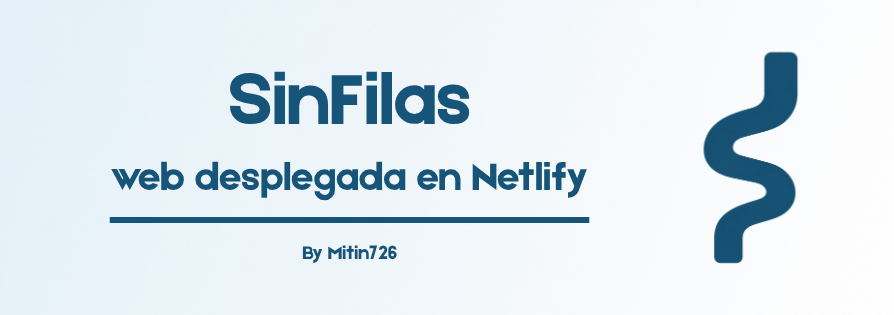

# SinFilas — Landing Page

<br>
🔗 **Sitio en vivo:** https://sinfilas.netlify.app/

## ¿Qué es esto?

Esta es la página web que hice para presentar el proyecto **SinFilas**. Su propósito es explicar, de forma simple y cercana, el problema que busco resolver y presentar a **Alba**, el asistente virtual de Telegram que desarrollé como solución.

No es una aplicación con funcionalidad propia: es una landing page informativa, pensada como material de apoyo para dar a conocer el proyecto y dirigir a las personas hacia Alba para que puedan probarla directamente.

## El problema que presento

Muchas personas, especialmente adultas mayores o con movilidad reducida, hacen largas filas en farmacias o centros de salud para reclamar un medicamento, y al llegar su turno descubren que no hay disponibilidad. Esto genera pérdida de tiempo, desgaste físico y frustración, sobre todo cuando el desplazamiento pudo evitarse.

## La solución que presento

La idea es simple: permitir que la persona consulte la disponibilidad de un medicamento **antes de salir de casa**, escribiéndole a Alba por Telegram como si fuera un mensaje de texto normal. En segundos, Alba responde si el medicamento está disponible, evitando así el viaje y la fila si no lo está.

## Contenido de la página

La web está organizada en una sola página con scroll, dividida en estas secciones:

1. **Hero**: el problema, el botón para escribirle a Alba y un celular con una conversación real
2. **El problema**: las filas y los desplazamientos innecesarios
3. **La solución**: la idea general antes de presentar a Alba
4. **Conoce a Alba**: presentación del asistente virtual
5. **Cómo funciona**: 3 pasos simples de uso
6. **Escríbele así**: ejemplos de mensajes listos para copiar
7. **Qué te responde Alba**: respuesta cuando hay y cuando está agotado, con mensajes reales
8. **¿Primera vez con Telegram?**: guía para instalar Telegram y abrir el chat
9. **Preguntas frecuentes**: costo, privacidad, errores de escritura y estado del prototipo
10. **Llamado a la acción final** y **footer**

En celulares hay además un botón fijo abajo para escribirle a Alba en cualquier momento.

### Accesibilidad

- Letra base de 20 px y control **A / A+ / A++** que agranda toda la página (se recuerda en el navegador).
- Botón **«Escuchar esta sección»** en cada sección: lee el texto en voz alta con la voz del navegador, en español y un poco más despacio.
- **Código QR** (en computadores) para abrir el chat de Alba con la cámara del celular.
- Contraste de color nivel **AAA** (7:1), foco bien visible al navegar con el teclado y enlace «Saltar al contenido principal».
- Sin scroll horizontal en ningún tamaño de letra, desde pantallas de 320 px.

El diseño está pensado especialmente para personas adultas mayores: texto grande, alto contraste, lenguaje simple sin tecnicismos, y botones grandes y claros.

## Tecnologías usadas

- **[Astro](https://astro.build/)**: genera HTML estático; la página no envía JavaScript al navegador
- **HTML5** semántico y **CSS3** (variables CSS, Flexbox/Grid, diseño responsive), con estilos aislados por componente
- **TypeScript** para los datos y la configuración del sitio
- **Playwright** para pruebas de regresión visual
- **ESLint** y **Prettier** para mantener el código ordenado
- Desplegado en **Netlify**, con actualización automática cada vez que se sube un cambio al repositorio

## Desarrollo local

Requiere **Node.js 22.12 o superior**.

```bash
npm install          # instalar dependencias
npm run dev          # servidor de desarrollo en http://localhost:4321
npm run build        # generar el sitio en dist/
npm run preview      # ver el sitio generado
```

### Calidad del código

```bash
npm run lint         # ESLint
npm run format       # formatear con Prettier
npm run check        # verificación de tipos de Astro/TypeScript
npm test             # todas las pruebas: visuales y de accesibilidad
npm run test:visual  # comparar la página contra las capturas de referencia
```

Las pruebas visuales comparan la página, píxel a píxel, con las capturas guardadas en `tests/__screenshots__/` (escritorio, tablet y móvil). Si un cambio de diseño es intencional, se actualizan con `npm run test:visual:update`. Las pruebas de accesibilidad (`tests/accesibilidad.spec.mjs`) usan axe-core para revisar WCAG 2.2 AA y el contraste AAA, y comprueban el control de tamaño de letra, la lectura en voz alta y que no haya scroll horizontal. Las capturas dependen del sistema operativo donde se generan, por eso se ejecutan en local y no en la integración continua (CI).

## Cómo probar el bot desde la web

En varias secciones de la página hay botones que dicen **"Habla con Alba"**, los cuales redirigen directamente al chat de Telegram del bot: `https://t.me/medicamentos_alba_bot`.

**Importante:** Alba solo responde mientras el bot esté corriendo activamente desde el equipo donde se ejecuta el proyecto (ver el README del bot). Al ser un prototipo, no está desplegado en un servidor permanente, así que puede que en algún momento el bot no responda si no está encendido.

## Estructura del proyecto

```
sinfilas-web/
├── public/images/          # imágenes servidas tal cual (logo, Alba, ilustración)
├── src/
│   ├── components/         # una sección de la página por componente
│   │   ├── chat/           # burbuja de chat y celular con la conversación de Alba
│   │   ├── Header.astro, Hero.astro, Problema.astro, Solucion.astro, Alba.astro
│   │   ├── ComoFunciona.astro, Ejemplos.astro, Respuestas.astro
│   │   ├── PrimeraVez.astro, PreguntasFrecuentes.astro, LlamadoAccion.astro
│   │   ├── Footer.astro, BotonFijoMovil.astro, AvisoPrototipo.astro
│   │   └── EnlaceTelegram.astro
│   ├── config/site.ts      # datos generales: nombre, enlace del bot, aviso de prototipo
│   ├── data/               # textos: navegación, problemas, pasos, chat, ejemplos y preguntas
│   ├── layouts/BaseLayout.astro
│   ├── pages/index.astro   # la página: une todos los componentes
│   └── styles/global.css   # variables de diseño, base y botones
├── tests/                  # pruebas de regresión visual (Playwright)
├── docs/                   # recursos del README
├── astro.config.mjs
└── netlify.toml            # build en Netlify: npm run build → dist/
```

Para cambiar el enlace del bot basta con editarlo en `src/config/site.ts`. Cuando Alba deje de ser un prototipo, cambia `esPrototipo` a `false` en ese mismo archivo para ocultar el aviso. Para añadir un paso o un problema, se agrega un elemento a la lista correspondiente en `src/data/`.

## Estado actual del proyecto

Este es un prototipo funcional, hecho como parte de la presentación (pitch) del proyecto SinFilas, con el objetivo de comunicar el problema, la solución y dar a conocer a Alba de forma visual y profesional.

Made with ❤️ by Mitin726
